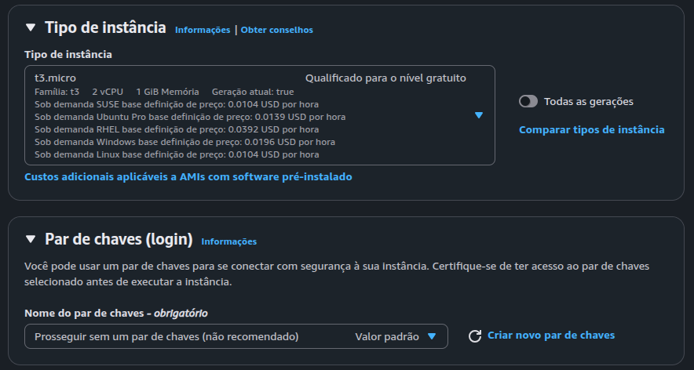
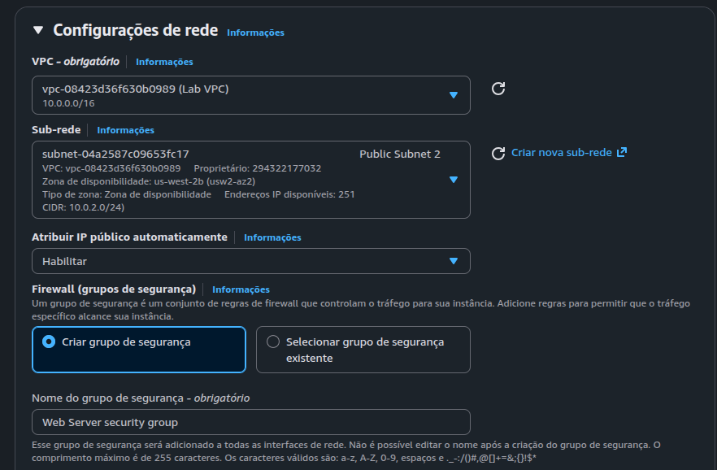
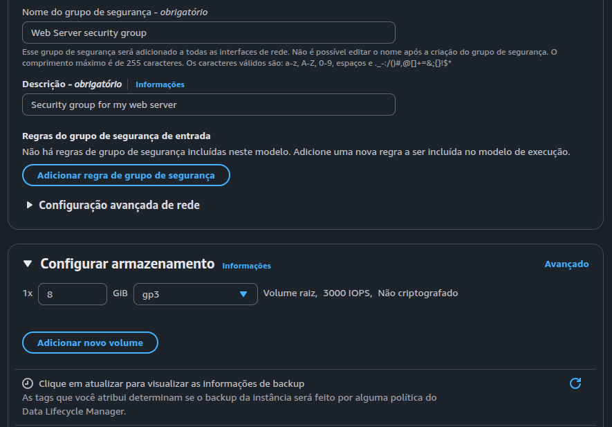
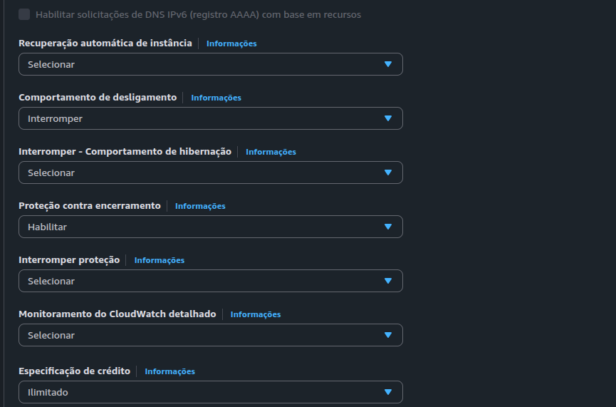
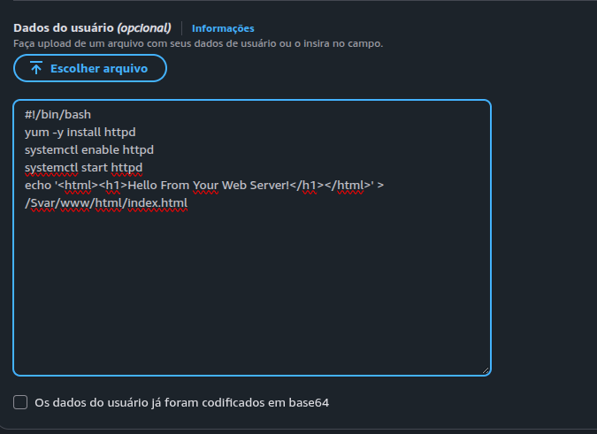
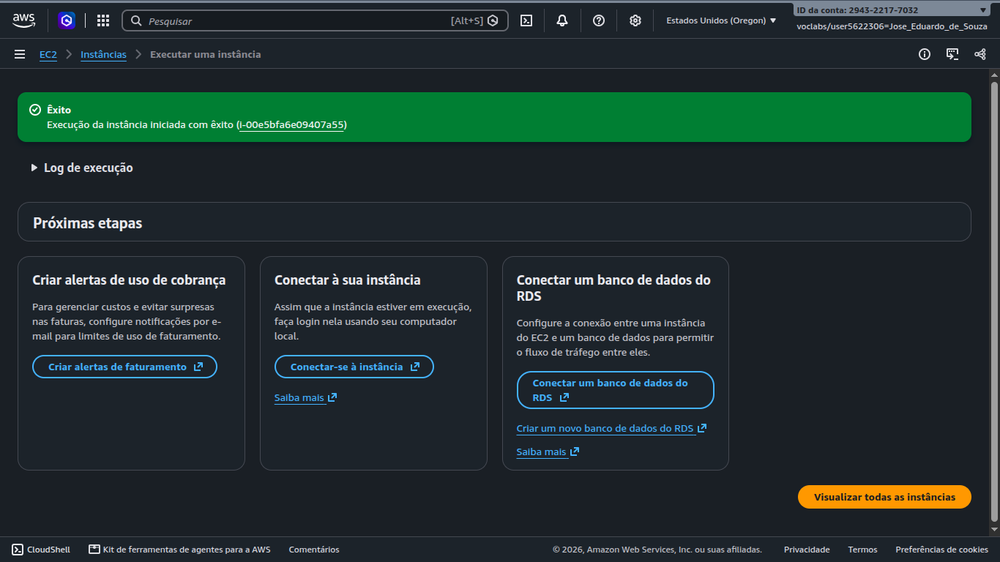
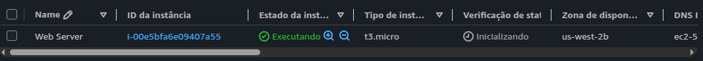
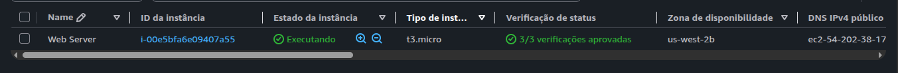

# Lab 01 — Amazon EC2 | Provisionamento e Segurança

**Plataforma:** Escola da Nuvem — Vocareum  
**Laboratório:** Introduction to Amazon EC2  
**Data:** 31/10/2026  
**Região AWS:** us-west-2 (Oregon)  
**Status:** Parcialmente concluído — sessão encerrada

---

## 1. Visão geral

Neste laboratório, realizei o provisionamento de uma
instância Amazon EC2 utilizando Amazon Linux 2023.

Meu objetivo foi desenvolver conhecimentos práticos
sobre infraestrutura em nuvem, configuração de redes,
segurança, armazenamento e automação de servidores.

Executei as atividades no ambiente educacional da
Escola da Nuvem, disponibilizado por meio do Vocareum.

Ao longo do exercício, registrei as configurações,
os testes realizados, as evidências e as limitações
encontradas.

## 2. Objetivos

Estabeleci os seguintes objetivos para o laboratório:

- Provisionar uma instância Amazon EC2.
- Configurar uma VPC e uma sub-rede.
- Criar e associar um Security Group.
- Configurar armazenamento Amazon EBS.
- Automatizar a instalação do Apache com User Data.
- Verificar a integridade da instância.
- Explorar o monitoramento com Amazon CloudWatch.
- Testar a conectividade HTTP.
- Conhecer o redimensionamento de recursos.
- Testar a proteção contra encerramento.

Nem todos os objetivos foram concluídos durante
a sessão disponível.

## 3. Tecnologias utilizadas

| Tecnologia | Finalidade |
|---|---|
| Amazon EC2 | Computação virtual |
| Amazon Linux 2023 | Sistema operacional |
| Amazon VPC | Rede virtual |
| Security Groups | Controle de tráfego |
| Amazon EBS | Armazenamento em blocos |
| Apache HTTP Server | Servidor web |
| Bash | Automação |
| EC2 User Data | Configuração inicial |
| Amazon CloudWatch | Monitoramento |
| Linux e curl | Testes de conectividade |

## 4. Arquitetura do ambiente

Configurei uma instância EC2 em uma sub-rede
pública da Lab VPC.

O ambiente utilizou atribuição automática de
IPv4 público e um Security Group sem regras
de entrada.

Estrutura lógica simplificada:

```text
Internet
   |
   | HTTP / TCP 80
   |
Security Group
   | Sem regras de entrada
   | Tráfego HTTP bloqueado
   |
Lab VPC — 10.0.0.0/16
   |
Public Subnet 2 — 10.0.2.0/24
   |
Amazon EC2 — Web Server
   |
Amazon Linux 2023
   |
Amazon EBS — 8 GiB gp3
```

O bloqueio inicial da porta 80 foi intencional,
conforme o roteiro do laboratório.

## 5. Provisionamento da instância

Acessei o Console AWS, selecionei o serviço
Amazon EC2 e iniciei a criação da instância.

Utilizei as seguintes configurações:

| Recurso | Configuração |
|---|---|
| Nome | Web Server |
| AMI | Amazon Linux 2023 |
| Arquitetura | x86_64 |
| Tipo | t3.micro |
| vCPU | 2 |
| Memória | 1 GiB |
| Região | us-west-2 |
| Zona | us-west-2b |
| VPC | Lab VPC |
| CIDR da VPC | 10.0.0.0/16 |
| Sub-rede | Public Subnet 2 |
| CIDR da sub-rede | 10.0.2.0/24 |
| IPv4 público automático | Habilitado |
| Par de chaves | Não configurado |
| EBS | 8 GiB gp3 |
| Proteção contra encerramento | Habilitada |

Não configurei um par de chaves porque o roteiro
não exigia acesso SSH à instância.

### 5.1. Configuração de segurança

Criei um Security Group denominado:

`Web Server security group`

Inicialmente, removi todas as regras de entrada,
incluindo a regra SSH que estava configurada
por padrão.

Dessa forma, preparei o ambiente para demonstrar
o comportamento de uma conexão HTTP bloqueada.

### 5.2. Armazenamento

Mantive o volume raiz Amazon EBS com capacidade
de 8 GiB e tipo gp3.

A expansão para 10 GiB estava prevista no
laboratório, mas não chegou a ser executada.

### 5.3. Proteção contra encerramento

Habilitei a proteção contra encerramento durante
o provisionamento.

O teste prático dessa proteção ficou pendente
devido ao encerramento da sessão.

## 6. Automação com User Data

Configurei um script Bash para executar
comandos de instalação e inicialização do
Apache HTTP Server durante o primeiro boot.

Utilizei o seguinte script:

```bash
#!/bin/bash
yum -y install httpd
systemctl enable httpd
systemctl start httpd
echo '<html><h1>Hello From Your Web Server!</h1></html>' > /var/www/html/index.html
```

O arquivo está disponível em:

[scripts/user-data.sh](scripts/user-data.sh)

O script foi preparado para instalar o Apache,
habilitar sua inicialização automática, iniciar
o serviço e criar uma página HTML.

A execução interna do script não foi verificada
por logs ou por acesso ao conteúdo HTTP.

## 7. Validação da instância

Após solicitar a execução, recebi a confirmação
de que a AWS havia iniciado o provisionamento.

Em seguida, acessei a lista de instâncias e
confirmei que a Web Server estava em execução.

Inicialmente, as verificações de status ainda
estavam em processo de inicialização.

Posteriormente, confirmei os seguintes resultados:

| Verificação | Resultado |
|---|---|
| Estado da instância | Executando |
| Status do sistema | Aprovado |
| Status da instância | Aprovado |
| Status do EBS | Aprovado |
| Total de verificações | 3/3 |

O roteiro original mencionava duas verificações,
mas o console apresentou três.

Registrei o resultado efetivamente observado.

Essas verificações demonstraram que a infraestrutura
passou nos testes automáticos da AWS naquele momento.

## 8. Monitoramento e diagnóstico

Acessei as seções Status e alarmes e Monitoramento
para explorar os recursos de diagnóstico da EC2.

### 8.1. Amazon CloudWatch

Ao tentar consultar as métricas, encontrei
restrições de autorização.

As operações apresentadas nos erros incluíam:

- `cloudwatch:ListMetrics`
- `cloudwatch:GetMetricData`

A primeira apresentou bloqueio por política SCP,
e a segunda, por política IAM.

Não consegui analisar numericamente as métricas
de CPU, rede ou créditos de CPU.

Como o ambiente era gerenciado pelo Vocareum,
mantive as permissões originais.

### 8.2. Captura do console

Também tentei utilizar o recurso
Get Instance Screenshot.

A operação foi bloqueada por ausência de
permissão para:

`ec2:GetConsoleScreenshot`

Essa restrição impediu a obtenção da captura
do console da máquina virtual.

As três verificações de integridade da EC2
continuavam aprovadas.

## 9. Teste de conectividade HTTP

Realizei um teste de conectividade a partir
do terminal do meu computador Linux.

Utilizei o comando curl:

```bash
curl -I --connect-timeout 5 --max-time 10 \
  "http://54.202.38.173"
```

O endereço utilizado correspondia ao IPv4
público atribuído à instância durante o laboratório.

O terminal retornou:

```text
curl: (28) Connection timed out after 5002 milliseconds
```

O teste demonstrou que não foi possível estabelecer
a conexão HTTP no intervalo configurado.

Esse resultado foi compatível com a ausência de
regras de entrada no Security Group.

A liberação da porta TCP 80 e o teste posterior
não foram realizados.

Portanto, não confirmei o funcionamento público
da página HTML do Apache.

## 10. Encerramento da sessão

Durante a continuidade do laboratório, perdi
a autorização para consultar a lista de instâncias.

A AWS apresentou um erro de acesso negado
para a operação:

`ec2:DescribeInstances`

Ao retornar ao Vocareum, verifiquei que o
temporizador da sessão estava em 00:00.

A plataforma exibia a pontuação 1/1.

Interrompi as alterações e preservei a
documentação e as evidências disponíveis.

O encerramento da sessão não foi considerado
comprovação do encerramento da instância EC2.

## 11. Resultados das atividades

| Atividade | Situação |
|---|---|
| Provisionamento EC2 | Concluído |
| Configuração de VPC e sub-rede | Concluída |
| Configuração do Security Group | Concluída |
| Volume EBS de 8 GiB | Configurado |
| User Data | Configurado |
| Proteção contra encerramento | Habilitada |
| Integridade da EC2 | 3/3 aprovadas |
| Consulta de métricas CloudWatch | Acesso restrito |
| Captura do console | Acesso restrito |
| Teste HTTP inicial | Timeout confirmado |
| Liberação da porta 80 | Não realizada |
| Validação da página Apache | Não realizada |
| Alteração para t3.small | Não realizada |
| Expansão EBS para 10 GiB | Não realizada |
| Teste de proteção contra encerramento | Não realizado |
| Encerramento da EC2 | Não confirmado |

## 12. Evidências

Organizei as capturas obtidas durante a primeira
parte do laboratório no diretório `evidencias/`.

### 12.1. Tipo de instância



### 12.2. Configuração da VPC



### 12.3. Segurança e armazenamento



### 12.4. Proteção contra encerramento



### 12.5. Configuração do User Data



### 12.6. Lançamento da instância



### 12.7. Instância em execução



### 12.8. Verificações de integridade



As imagens serão revisadas para ocultar
informações desnecessárias antes da publicação.

## 13. Aprendizados

Durante este laboratório, desenvolvi uma
compreensão mais prática sobre:

- O provisionamento de servidores virtuais.
- A relação entre EC2, VPC e sub-redes.
- O funcionamento dos Security Groups.
- O uso do EBS como armazenamento persistente.
- A configuração automatizada com User Data.
- As verificações de integridade da AWS.
- A diferença entre falhas de infraestrutura
  e restrições de autorização IAM.
- O uso do curl para testes de conectividade.
- A importância de preservar evidências técnicas.

Também compreendi que uma instância com
verificações de integridade aprovadas não
significa necessariamente que sua aplicação
web esteja acessível.

## 14. Conclusão

Concluí parcialmente o laboratório Introduction
to Amazon EC2, realizado na Escola da Nuvem.

Consegui provisionar uma instância Linux,
configurar seus recursos de rede e segurança,
preparar a automação do Apache e validar
as verificações de integridade da AWS.

O teste inicial de conectividade demonstrou
um tempo limite de conexão HTTP, compatível
com o bloqueio configurado no Security Group.

As restrições de permissões e o encerramento
da sessão impediram a realização das últimas
atividades previstas.

Mesmo sem concluir todas as tarefas, utilizei
a experiência para aprofundar meus conhecimentos
sobre computação em nuvem, segurança e diagnóstico
de infraestrutura AWS.

Preservei os resultados e as evidências para
consulta e continuidade dos meus estudos.

---

**Situação final:** laboratório parcialmente concluído,
com evidências e resultados técnicos documentados.
